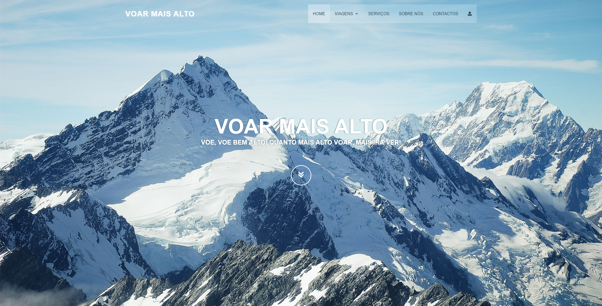
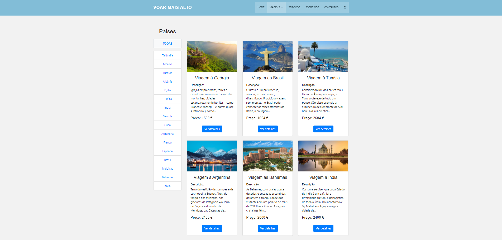
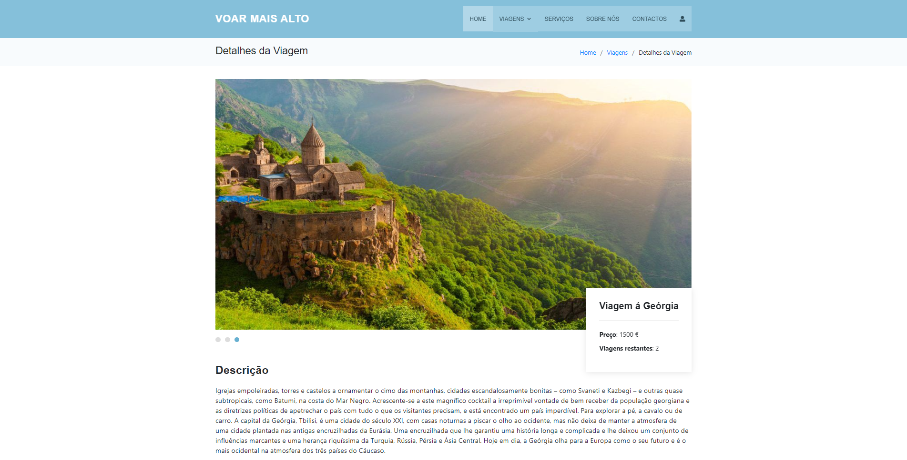
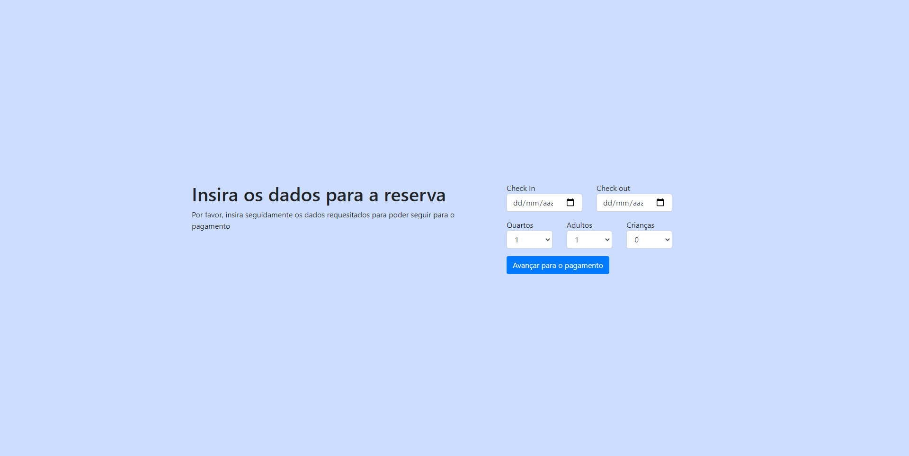
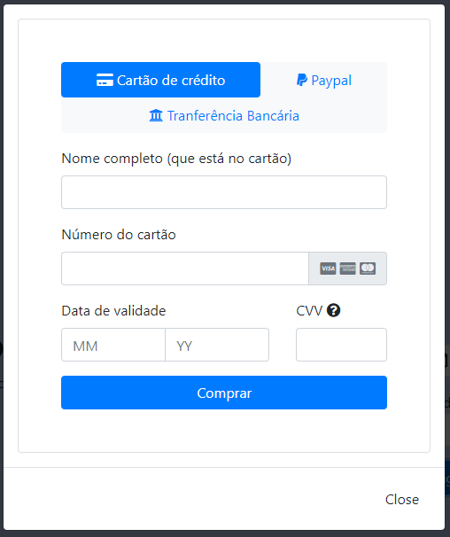
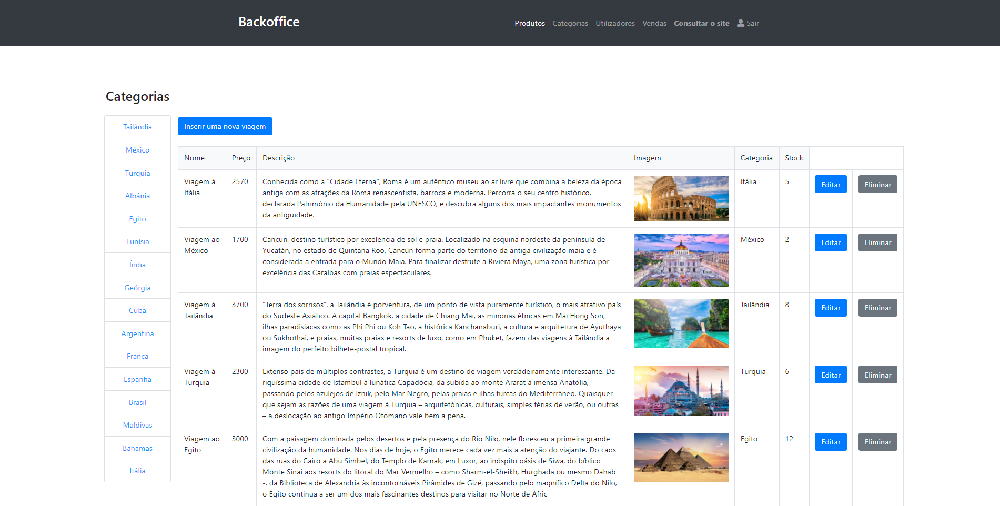
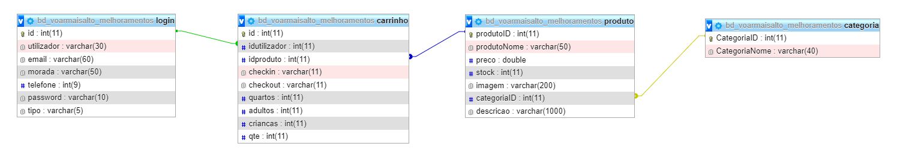

# Voar Mais Alto

PAP (Prova de Aptidão Profissional) - Curso Profissional de Técnico de Gestão e Programação de Sistemas Informáticos

Escola Secundária José Saramago - Mafra, 2020/2021

Tiago Cabaça nº21 PI3

Professor orientador: Marco Silva

## Sobre o projeto

O Voar Mais Alto é um site de uma agência de viagens. No site é possível ver as viagens, filtrar por destino, criar conta, fazer login e reservar uma viagem.

Também tem um backoffice para o administrador onde se pode adicionar, alterar e eliminar viagens, destinos e utilizadores e ver as viagens vendidas.

## Feito com

- PHP
- MySQL
- HTML, CSS e JavaScript
- Bootstrap
- XAMPP

## Como usar

1. Instalar o XAMPP e ligar o Apache e o MySQL
2. Copiar a pasta do projeto para o htdocs
3. No phpMyAdmin importar o ficheiro db/bd_voarmaisalto.sql
4. Abrir no browser http://localhost/voar-mais-alto

Para entrar como administrador:

- Email: admin@voarmaisalto.pt
- Password: admin

Os outros utilizadores têm a password teste123

## Imagens

